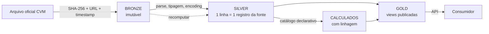
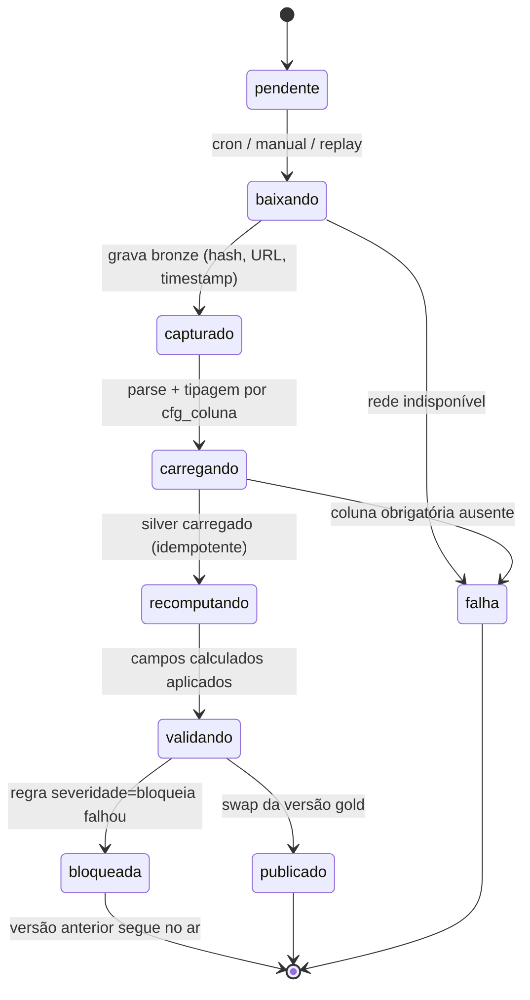
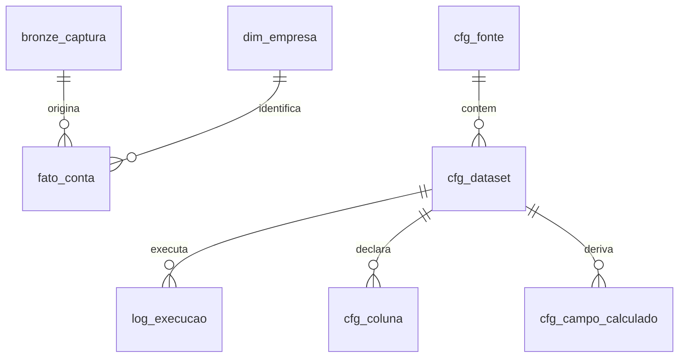

# Portal de Dados — definição do sistema e arquitetura proposta

**Status:** implementado (fases 1–5, etapas 0–7) · **Versão:** 2.0 · **Data:** 2026-07-30
**Escopo deste documento:** o que o sistema é, que garantias oferece, como é
construído e por quê. Decisões com alternativa descartada estão registradas em
[Decisões arquiteturais](#11-decisões-arquiteturais); o que ainda não foi
decidido está em [Questões em aberto](#14-questões-em-aberto). O plano de
execução por fases vive em
[prompt-portal-dados-otimizado.md](../prompt-portal-dados-otimizado.md).

---

## 1. Definição do sistema

### 1.1 Problema

Análise fundamentalista de empresas da B3 depende do dado oficial que a CVM
publica. Esse dado é distribuído como ZIPs anuais de CSVs — não há API — e é
**padronizado, não normalizado**: chega consistente em formato e ambíguo em
semântica. Sete armadilhas (§ [Apêndice A](#apêndice-a--as-sete-armadilhas-do-dado-da-cvm))
fazem com que uma soma ingênua produza número errado sem nenhum erro visível.

Existem APIs de terceiros (brapi, dadosdemercado) que resolvem a ergonomia, mas
nenhuma delas é o dado auditado. E todas cobram, ou limitam, ou somem.

### 1.2 O que o sistema é

Um **portal de API de dados de mercado** com plano de controle próprio: a
recepção, o tratamento e a carga de cada fonte são configurados por interface,
não por código. Novas fontes entram como configuração; a CVM é apenas a
primeira delas.

Duas metades, deliberadamente separadas:

| | Plano de controle | Plano de dados |
|---|---|---|
| Responde | "como esse dado deve ser recebido e tratado?" | "que dado eu tenho e o que ele vale?" |
| Escrito por | operador, pela UI | motor de ingestão |
| Tabelas | `cfg_*`, `log_execucao` | `bronze_captura`, silver, gold |
| Muda | raramente, e sempre versionado | a cada execução |

### 1.3 Consumidores

| Consumidor | Como acessa | O que precisa |
|---|---|---|
| BOLSIA (análise fundamentalista) | `GET /v1/**` com chave de API | série histórica por empresa/conta, indicadores derivados, proveniência |
| Operador do portal | UI `/admin` | configurar fontes, campos calculados, regras e agendamento; ver execuções |
| Auditoria (o próprio Alex, depois) | consulta direta ao banco | reconstruir qualquer número até o arquivo oficial que o originou |

### 1.4 Princípios

1. **O dado oficial é intocável; o derivado é descartável.** Só o arquivo que a
   CVM publicou não pode ser reconstruído. Tudo o mais se recomputa.
2. **Configuração, não código.** Adicionar uma fonte, uma coluna ou um
   indicador não deve exigir deploy.
3. **Todo número tem endereço.** Qualquer valor devolvido pela API aponta para
   a captura que o originou e para a versão de configuração que o produziu.
4. **Custo zero por padrão.** Nada além do que o plano do Railway já inclui.
   Isso é restrição de arquitetura, não meta de gestão.
5. **Errado não publica.** Regra de qualidade bloqueante impede a promoção;
   o consumidor continua vendo a última versão boa.

### 1.5 Fora de escopo

Cotação intradiária e dados de pregão · terceiros como fonte de verdade (cabem
como atalho validado contra a CVM) · camada dbt · faturamento · execução do
deploy.

---

## 2. Visão de arquitetura

```mermaid
flowchart TB
    subgraph externo[Fontes externas]
        CVM[(CVM Dados Abertos<br/>ZIP/CSV latin-1)]
    end

    subgraph railway[Railway — projeto único]
        subgraph web[Serviço web · FastAPI]
            API[API pública /v1]
            ADMIN[UI /admin<br/>build estático]
            META[API de configuração /admin/api]
        end
        CRON[Cron job<br/>app.cli agendados]
        subgraph db[(Postgres — plano incluído)]
            CFG[Plano de controle<br/>cfg_*, log_execucao]
            BRONZE[bronze_captura<br/>imutável]
            SILVER[silver<br/>fato_conta, dim_empresa]
            GOLD[gold<br/>views publicadas]
        end
    end

    BOLSIA[BOLSIA] -->|chave de API| API
    OP[Operador] --> ADMIN
    ADMIN --> META --> CFG
    CRON -->|lê config| CFG
    CVM -->|download| CRON
    CRON -->|grava intacto| BRONZE
    BRONZE -->|parse + tipagem| SILVER
    SILVER -->|campos calculados| GOLD
    CRON -->|registra| LOG[log_execucao]
    API --> GOLD
```

**Um serviço web, um cron job, um banco.** Essa é a topologia inteira, e é uma
consequência direta do princípio 4: cada serviço adicional no Railway consome
recurso do plano. O front não tem servidor próprio — é build estático servido
pelo FastAPI. A ingestão não é thread dentro da API — é processo curto disparado
por cron, que sobe, trabalha e morre.

### 2.1 Camadas do dado



| Camada | Conteúdo | Mutabilidade | Reconstrutível? |
|---|---|---|---|
| **Bronze** | o ZIP/CSV como a CVM publicou, byte a byte, com hash, URL e `capturado_em` | **imutável** — nova captura é registro novo, nunca sobrescrita | ❌ **não** — é a única cópia |
| **Silver** | uma linha por registro da fonte, colunas originais tipadas | reconstruída a cada carga | ✅ do bronze |
| **Calculados** | derivados declarados em catálogo, com colunas de origem | recomputados sob demanda | ✅ do silver |
| **Gold** | views de consumo, já filtradas e corretas | republicadas por swap de versão | ✅ do silver + calculados |

**Tipagem não é transformação.** `"1.234,50"` → `1234.50` muda representação,
não valor, e a string original permanece acessível na mesma linha. A distinção
importa porque é ela que reconcilia "nenhum dado será transformado" com
"teremos campos calculados": o dado oficial não muda; o que o portal deriva
mora ao lado, identificado como derivado.

**Recomputar do bronze é rotina, não emergência.** É a forma padrão de corrigir
carga errada, mudança de regra ou bug de parsing. Corolário verificável: se
recomputar tudo não reproduzir o estado do banco, existe um bug — alguma coisa
entrou por fora do pipeline. Esse é um teste de aceite, não uma frase de
efeito.

---

## 3. Plano de controle — modelo de configuração

Toda tabela `cfg_*` é **append-only e versionada**: uma alteração insere uma
nova linha com `versao + 1` e marca a anterior como `vigente = false`. O motivo
não é auditoria genérica — é que uma reingestão de 2019 precisa saber sob qual
configuração o dado de 2019 foi carregado, sob pena de produzir um resultado
diferente do que a API já serviu.

### 3.1 `cfg_fonte` — de onde vem

| Coluna | Tipo | Nota |
|---|---|---|
| `id`, `versao`, `vigente` | — | chave lógica + versionamento |
| `nome` | text | `cvm_dados_abertos` |
| `tipo_transporte` | enum | `http_zip`, `http_csv`, `http_json` |
| `url_template` | text | `.../{DFP\|ITR}/DADOS/{tipo}_cia_aberta_{ano}.zip` |
| `encoding` | text | `latin-1` — errar aqui quebra `DENOM_CIA` e `DS_CONTA` |
| `separador` | char | `;` |
| `credencial_ref` | text | nome da variável de ambiente, nunca o segredo |

### 3.2 `cfg_dataset` — o que extrair de dentro

| Coluna | Nota |
|---|---|
| `fonte_id` | FK |
| `padrao_arquivo` | regex sobre o nome do CSV dentro do ZIP |
| `tabela_destino` | tabela silver |
| `chave_natural` | array de colunas — **base da idempotência** |
| `politica_versao` | `max_versao` (CVM), `append`, `upsert` |
| `particao` | `ano`, para janelar carga e recomputação |

### 3.3 `cfg_coluna` — contrato de schema

`nome_origem` → `nome_destino`, `tipo`, `formato` (`decimal_ptbr`, `date_iso`),
`obrigatoria`. É também o detector de mudança de layout: coluna obrigatória
ausente na captura falha a carga em vez de gravar nulo silencioso.

### 3.4 `cfg_campo_calculado` — o catálogo de derivadas

| Coluna | Nota |
|---|---|
| `nome` | `vl_conta_norm`, `is_latest`, `liquidez_corrente` |
| `classe` | `escalar` (linha a linha) ou `janela` (precisa de partição/ordenação) |
| `expressao` | SQL restrito (§ [4.3](#43-linguagem-de-expressão)) |
| `colunas_origem` | array — **validado contra `cfg_coluna`**; sem isso não salva |
| `particao_por` / `ordena_por` | só para `classe = janela` |
| `materializacao` | `coluna` (persistida em silver) ou `view` (calculada na leitura) |

A separação `escalar` / `janela` não é decorativa: `vl_conta_norm` é
`vl_conta * fator(escala_moeda)` — escalar. `is_latest` é
`versao = max(versao) over (partition by cd_cvm, tipo_doc, dt_refer)` — janela,
e **de partição global**, o que tem consequência operacional descrita em
§ [4.4](#44-recomputação).

### 3.5 `cfg_regra_qualidade`, `cfg_agendamento`, `cfg_chave_api`, `log_execucao`

| Tabela | Campos que importam |
|---|---|
| `cfg_regra_qualidade` | `expressao_sql` (deve retornar 0 linhas), `severidade` ∈ {`informa`, `alerta`, `bloqueia`}, `tolerancia` |
| `cfg_agendamento` | `cron`, `timezone` (`America/Sao_Paulo`), `janela_padrao` |
| `cfg_chave_api` | `consumidor`, `hash_chave`, `prefixo`, `quota_minuto`, `quota_dia`, `revogada_em` |
| `log_execucao` | `janela`, `status`, `trigger` (`cron`/`manual`/`replay`), `cfg_snapshot` (JSONB com as versões de config usadas), contagens e delta de linhas, `erro` |

`cfg_snapshot` é o que torna uma execução reproduzível meses depois: a config
mudou, mas o log sabe qual estava vigente.

---

## 4. Motor de ingestão

### 4.1 Ciclo



O passo `capturado` é o ponto de não-retorno do dado oficial: dali em diante,
qualquer erro é recuperável sem rede.

### 4.2 Idempotência

Carga por chave natural declarada em `cfg_dataset`. Para a CVM:
`(cd_cvm, tipo_doc, dt_refer, grupo, consolidado, cd_conta, ordem_exerc, versao)`.
Reexecutar a mesma janela substitui as linhas dessa chave; não acumula. Isso é
o que permite `replay` de um ano inteiro como operação segura de rotina.

### 4.3 Linguagem de expressão

Campos calculados e regras de qualidade são **SQL restrito**, avaliado pelo
banco: expressões escalares, funções de janela, agregações, `CASE`. Sem
subconsulta a tabela não declarada, sem DDL, sem função definida pelo usuário.

Três razões: recomputabilidade (o mesmo texto roda de novo e dá o mesmo
resultado), portabilidade entre Postgres e DuckDB, e superfície de ataque —
o campo é editável pela UI, então executar Python arbitrário ali seria RCE com
formulário.

### 4.4 Recomputação

`recomputar(janela)` dropa silver, calculados e gold da janela e reconstrói do
bronze, sem rede.

**Armadilha conhecida:** `is_latest` é de partição global por
`(cd_cvm, tipo_doc, dt_refer)`. Reingerir 2019 pode conter uma reapresentação
que rebaixa um documento já marcado como vigente. Recomputar só a janela deixa
o flag errado em ano que não foi tocado. Portanto: **campo calculado de classe
`janela` com partição que cruza janelas dispara recomputação global do campo**,
não da janela. O catálogo precisa saber disso, e é por isso que
`particao_por` é coluna e não comentário.

### 4.5 Publicação em gold

Duas metades, e a implementação mostrou que **só a segunda não basta**.

1. **Rótulo por linha.** Linha carregada nasce sem `publicado_em_versao`; gold
   só enxerga linha rotulada. Publicar rotula as pendentes.
2. **Ponteiro versionado.** Cada publicação cria `*_v{n}` e move o alias que a
   API lê. Reverter é mover o ponteiro de volta.

O ponteiro sozinho versiona a *definição* da view, não o dado que ela lê — com
gold sendo view sobre silver, uma carga reprovada apareceria para o consumidor
no mesmo instante em que fosse carregada. O rótulo é o que faz o gate valer;
o teste `test_versao_anterior_continua_no_ar_apos_bloqueio` existe para isso.
Bloqueio também descarta de silver as linhas sem rótulo da execução — dado já
publicado não é tocado.

Consequências:

- Regra bloqueante barra a promoção; o consumidor continua na versão íntegra.
- Rollback é mover o ponteiro de volta.
- `versao_publicacao` vira `ETag` na API (§ [6.4](#64-cache-e-custo)).

**Limite conhecido:** linha já publicada sobrescrita por upsert com valor
diferente muda em gold sem passar pelo gate — só ocorreria se a CVM
republicasse a mesma chave natural com outro valor. E `recomputar` de uma
janela cuja carga seja depois reprovada deixa a janela sem dado publicado até
a correção, porque as linhas antigas já foram removidas. A solução completa
para os dois é área de staging antes do merge — registrada como backlog.

---

## 5. Modelo de dados físico



| Tabela | Grão | Origem |
|---|---|---|
| `bronze_captura` | 1 arquivo baixado | download — [ADR-10](#adr-10--bronze-em-tabela-não-em-volume) |
| `fato_conta` | 1 conta contábil, por grupo, empresa, período e versão de documento | gerada por `app/motor/ddl.py` a partir de `cfg_classe`/`cfg_atributo`; a tabela é consequência da classe (ADR-11) |
| `dim_empresa` | 1 companhia aberta | `cad_cia_aberta.csv` — **hoje fora do loop** |
| `gold.demonstracoes` | view: `is_latest` ∧ `ordem_exerc = 'ÚLTIMO'` ∧ `consolidado` fixo | derivada |
| `gold.itr_trimestre_isolado` | view: acumulado − acumulado anterior do mesmo exercício | derivada |

`fato_conta` carrega, lado a lado: `vl_conta` (oficial), `vl_conta_norm`
(calculado), `escala_moeda`, `versao`, `ordem_exerc`, `st_conta_fixa`,
`is_latest`, `itr_acumulado`, `fonte_arquivo`. Nada do oficial é substituído
pelo derivado.

### 5.1 `bronze_captura`

```sql
CREATE TABLE bronze_captura (
  id            bigserial PRIMARY KEY,
  dataset_id    bigint NOT NULL REFERENCES cfg_dataset(id),
  url           text   NOT NULL,
  nome_arquivo  text   NOT NULL,
  sha256        char(64) NOT NULL,
  tamanho_bytes bigint NOT NULL,
  capturado_em  timestamptz NOT NULL DEFAULT now(),
  payload       bytea  NOT NULL,
  UNIQUE (dataset_id, sha256)          -- recaptura idêntica não duplica
);

-- ZIP já vem comprimido: poupa o Postgres de tentar comprimir de novo.
ALTER TABLE bronze_captura ALTER COLUMN payload SET STORAGE EXTERNAL;

-- Imutabilidade deixa de ser promessa e vira constraint.
CREATE FUNCTION bronze_imutavel() RETURNS trigger AS $$
BEGIN
  RAISE EXCEPTION 'bronze_captura é imutável: % em captura %', TG_OP, OLD.id;
END $$ LANGUAGE plpgsql;

CREATE TRIGGER trg_bronze_imutavel
  BEFORE UPDATE OR DELETE ON bronze_captura
  FOR EACH ROW EXECUTE FUNCTION bronze_imutavel();
```

O `UNIQUE (dataset_id, sha256)` faz recaptura de conteúdo idêntico ser no-op —
necessário porque o cron rebaixa o mesmo ano com frequência e só algumas
capturas trazem reapresentação nova.

**Por que guardar o binário, e não só o hash e a URL:** a URL da CVM não é
arquivo, é endereço mutável. `dfp_cia_aberta_2023.zip` é regerado quando uma
empresa reapresenta, então rebaixar amanhã não reproduz a captura de hoje. É
isso que torna o bronze irreconstituível.

**Retenção:** todas as capturas dos últimos 24 meses, mais a última de cada
`(dataset, ano)` para o histórico. A purga exige `ALTER TABLE ... DISABLE
TRIGGER` explícito — apagar bronze é ato deliberado, nunca `DELETE` distraído.

---

## 6. API pública

### 6.1 Contrato

```
GET /v1/empresas?q=&setor=&cursor=
GET /v1/empresas/{cd_cvm}
GET /v1/empresas/{cd_cvm}/demonstracoes?tipo=DFP|ITR&grupo=&de=&ate=&consolidado=
GET /v1/empresas/{cd_cvm}/metricas?nomes=liquidez_corrente,margem_liquida
GET /v1/meta/datasets
GET /v1/meta/campos-calculados
GET /health
```

Versionamento no path. `/v1` só sofre adição de campo; remoção ou mudança de
semântica abre `/v2`.

### 6.2 Proveniência

Toda resposta de dado carrega `fonte`, `dt_captura`, `versao_documento` e
`calculado_em`. Não é metadado opcional: é o que separa este portal de um
scraper, e o que permite ao consumidor saber que um número mudou porque a
empresa reapresentou, não porque o portal errou.

### 6.3 Autenticação e quota

Chave de alta entropia (32 bytes), formato `pd_{prefixo}_{segredo}`. Armazena-se
`sha256(segredo)` e o `prefixo` em claro, para lookup em índice. **Não** se usa
bcrypt/argon2 aqui: são desenhados para segredos de baixa entropia escolhidos
por humanos; para chave aleatória de 256 bits, SHA-256 é seguro e não custa
dezenas de milissegundos por request — o que, num serviço com CPU limitada,
seria a maior fatia do tempo de resposta.

Quota por minuto e por dia, contadas por chave. Estouro → `429` com
`Retry-After`.

### 6.4 Cache e custo

Gold só muda quando uma publicação acontece. Logo: `ETag` derivado de
`versao_publicacao` + parâmetros da query, `Cache-Control` longo,
`304 Not Modified` no revalidate. É a alavanca de custo mais barata do sistema —
o BOLSIA repetindo a mesma consulta não gasta CPU.

### 6.5 Erros

Shape único: `{ "erro": { "codigo", "mensagem", "detalhe" } }`. Códigos
estáveis (`chave_invalida`, `quota_excedida`, `empresa_nao_encontrada`,
`parametro_invalido`), porque cliente que faz parsing de mensagem quebra
quando o texto melhora.

---

## 7. Plano de controle — interface

Sete telas, servidas em `/admin`: **Fontes**, **Datasets**, **Campos
calculados**, **Qualidade**, **Execuções**, **Chaves de API**, **Catálogo**.

Padrões que valem como critério de aceite, não como intenção: navegação por
teclado em todos os formulários; foco visível; rótulo associado a cada campo;
erro descrito em texto ao lado do campo que o causou; estado de carregamento e
estado vazio em cada listagem; ação destrutiva com confirmação que nomeia o
objeto; contraste mínimo AA.

Duas telas carregam responsabilidade de correção, não só de cadastro:

- **Campos calculados** valida contra `cfg_coluna` no momento de salvar e
  mostra preview sobre amostra real. Campo que referencia coluna inexistente é
  rejeitado com mensagem que nomeia a coluna.
- **Execuções** oferece replay de janela — a interface da operação de correção
  padrão do sistema.

---

## 8. Infraestrutura — Railway

| Componente | Forma |
|---|---|
| Serviço web | FastAPI (uvicorn), bind em `0.0.0.0:$PORT`, serve API + estático |
| Cron | comando da CLI, processo curto, mesma imagem |
| Banco | Postgres do Railway, via `DATABASE_URL` injetada |
| Config | `railway.json` + `.env.example` versionados |
| Healthcheck | `GET /health`, responde sem tocar no banco |

**O filesystem do container é efêmero.** Gravar bronze em disco local do
serviço web perde o dado oficial no primeiro redeploy — exatamente o único dado
que não se reconstrói. Por isso o bronze mora em tabela, não em volume nem em
disco: ver [ADR-10](#adr-10--bronze-em-tabela-não-em-volume). Nenhum serviço
depende de estado em disco; o container pode ser destruído a qualquer momento.

**Sobre o custo:** o Railway não tem um tier de banco gratuito separado — o
Postgres é serviço cobrado por uso, coberto pelos créditos que o plano já
inclui. Na prática, sem gasto adicional; na prática também, não ilimitado. Daí
o serviço único, o cache agressivo e a política de retenção de bronze.

Em desenvolvimento local, sem `DATABASE_URL`, o sink é DuckDB em arquivo —
zero setup, mesma modelagem, mesmos testes.

---

## 9. Segurança

| Superfície | Tratamento |
|---|---|
| Chaves de API | hash em repouso, prefixo indexado, revogação imediata |
| Expressões editáveis pela UI | SQL restrito, sem DDL, sem UDF, sem tabela não declarada — o campo é entrada de usuário |
| Credenciais de fonte | só o nome da variável de ambiente vai para o banco |
| Dado oficial | hook `PreToolUse` bloqueia escrita em `bronze/` e DDL contra tabelas de captura, inclusive durante desenvolvimento assistido |
| `/admin` | autenticado; separado da API pública |
| LGPD | dado de companhia aberta é público; não há dado pessoal de terceiros no escopo atual. Se um dataset futuro trouxer administradores nomeados, reavaliar |

---

## 10. Observabilidade

`log_execucao` é a fonte primária: status, duração, contagens por camada, delta
de linhas contra a execução anterior, snapshot de configuração, erro.

Três sinais que valem alerta desde o começo, porque são as falhas silenciosas
do domínio:

1. **Delta de volume anômalo** — carga que traz 3% das linhas da anterior
   geralmente é layout mudado, não empresa fechando.
2. **Regra bloqueante disparada** — Ativo ≠ Passivo + PL fora da tolerância.
3. **Captura sem publicação** — dado baixado que não chegou em gold: pipeline
   parado no meio.

---

## 11. Decisões arquiteturais

| # | Decisão | Alternativa descartada | Por quê |
|---|---|---|---|
| 1 | Configuração em banco, versionada | YAML versionado no repo | as telas precisam editar em runtime; YAML daria auditoria melhor e UX pior, e o produto **é** o plano de controle |
| 2 | Bronze imutável + recomputação | correção in-place em silver | correção in-place torna o histórico não reproduzível e o bug indetectável |
| 3 | Postgres do Railway em prod; DuckDB só em dev | DuckDB em produção com volume | volume é estado a operar; o Postgres já vem no plano e o pacote suporta os dois sinks |
| 4 | Serviço único (API + estático) | front em serviço/host separado | dois serviços consomem o dobro de recurso do plano para servir arquivo estático |
| 5 | SQL restrito para campos calculados | plugin Python por campo | recomputabilidade, portabilidade entre sinks, e não abrir RCE via formulário |
| 6 | Publicação por swap de versão | escrita direta na view de consumo | é o que permite "errado não publica" sem janela de dado quebrado |
| 7 | Sem dbt | camada gold em dbt | dbt duplicaria o catálogo de campos calculados, que é o produto; e adiciona runtime a operar |
| 8 | Cron do Railway | Celery/Redis, ou GitHub Actions | fila é serviço a mais; runner externo tira a ingestão de onde o banco está |
| 9 | CVM como fonte canônica | brapi/dadosdemercado | só a CVM é o dado auditado; terceiro entra como atalho validado contra ela |
| 10 | Bronze como `bytea` em tabela Postgres | volume do Railway | ver ADR-10 abaixo |
| 11 | Classe de informação acima do dataset; tabela gerada da configuração | `CREATE TABLE` por migração escrita à mão | enquanto o DDL estiver no código, criar classe pela interface exige deploy — o oposto do produto |
| 12 | Multi-fonte por derivação, com `origem_dataset` na identidade física | upsert com a última carga vencendo | sobrescrever apaga a divergência antes de alguém poder decidir; derivar mantém as duas e torna a escolha reversível |
| 13 | Precedência declarada por atributo | precedência por fonte inteira | o cadastro da CVM é a melhor fonte para a razão social e não diz nada sobre o resto |
| 14 | Escopo de chave de API em classe de informação | escopo por rota ou por vista | rota é detalhe de implementação; a classe é o que o consumidor entende, e app novo vira chave nova |
| 15 | Carga por staging sem índice + upsert em uma instrução | upsert linha a linha | 300 linhas/s tornava o recomputo do bronze — o plano de volta de toda migração — lento demais para alguém acionar |
| 16 | Postgres do Railway, confirmado por medição | DuckDB em volume, um serviço só | o custo marginal é zero dentro do plano já contratado; ver ADR-16 abaixo |
| 17 | Suíte roda nos dois dialetos, não só no de desenvolvimento | testar em DuckDB e confiar no Postgres | o caminho Postgres nunca tinha sido executado, e a primeira execução achou um bug que matava o deploy no boot |

### ADR-11 — a tabela como consequência da classe

**Contexto.** Até a etapa 3, `fato_conta` e `dim_empresa` eram `CREATE TABLE`
escritos na migração `0004`, e as vistas de gold eram um dicionário em Python.
`cfg_dataset.tabela_destino` apontava para tabela que já tinha de existir.

**Decisão.** `cfg_classe` e `cfg_atributo` passam a ser a origem do DDL.
`motor.ddl` gera tabela, índice de identidade e ALTERs; `cfg_vista` guarda o
corpo das vistas de gold. A migração `0004` fica só com `publicacao`, que é do
sistema e não de classe nenhuma.

**Consequência.** Criar uma classe de informação nova é um POST em
`/admin/api/classes` — a tabela nasce na mesma chamada. O DDL histórico
permanece em `migracoes.DDL_HISTORICO_SILVER` como referência de regressão: é
contra ele, e não contra o próprio gerador, que o teste compara.

**O que a decisão custa.** A configuração passa a poder quebrar o banco. Três
guardas: nome de tabela validado antes de entrar em DDL, `ALTER ADD COLUMN`
mas nunca `DROP COLUMN` (coluna órfã vira divergência para alguém decidir, não
perda de dado), e um digest em `cfg_seed` que evita refazer índice a cada boot.

### ADR-12 — resolução multi-fonte é derivação, não sobrescrita

**Contexto.** Duas fontes descrevem a mesma empresa e discordam: o cadastro da
CVM traz `DENOM_SOCIAL`, o arquivo de DFP traz `DENOM_CIA`.

**Decisão.** `origem_dataset` entra na identidade física da tabela. As duas
linhas coexistem; a linha publicada sai de uma vista gerada que escolhe, por
atributo, o valor da fonte de maior precedência.

**Consequência.** Inverter precedência é republicar, não recarregar. Desligar
uma fonte não apaga o que ela trouxe. Só atributo realmente disputado ganha
coluna de origem, e ela chega ao consumidor dentro de `proveniencia.por_atributo`.

**Limite.** A vista resolvida agrupa por identidade. Numa classe de fonte
única isso seria um `GROUP BY` sobre centenas de milhares de linhas para não
decidir nada — por isso ela só é gerada para classe com `resolucao =
'precedencia'`.

### ADR-10 — bronze em tabela, não em volume

**Contexto.** O filesystem do container é efêmero, então o arquivo oficial
precisa de destino durável. Duas opções dentro do plano: volume do Railway, ou
coluna `bytea` em tabela. Volume de 16 anos de DFP+ITR estimado em 0,6–1,4 GB,
crescendo ~50–90 MB/ano mais recapturas.

**Decisão.** Tabela `bronze_captura`, com payload em `bytea`.

**Por quê.** Três razões, em ordem de peso:

1. **Volume monta em um serviço só.** A ingestão roda como cron (processo
   curto) e a API como serviço web. Com volume, só um dos dois enxerga o
   bronze — e as telas de Execuções e Catálogo, que precisam servir "o arquivo
   que originou este número", ficariam sem fonte, porque o processo com o mount
   não está no ar quando a requisição chega. Contornar isso exigiria fundir
   ingestão e API num serviço, contrariando a decisão 8.
2. **Imutabilidade deixa de ser convenção.** Volume é filesystem gravável;
   a garantia seria só disciplina. Em tabela, `REVOKE UPDATE, DELETE` mais
   trigger que levanta exceção tornam o princípio 1 executável pelo banco.
3. **Um caminho de backup.** O único dado irreconstituível do sistema passa a
   estar no mesmo backup que já existe, em vez de depender de política
   separada de volume.

**Custo empata**, o que foi o resultado inesperado da análise: o Postgres do
Railway persiste num volume, então as duas opções consomem o mesmo recurso do
plano. O delta é WAL e índice — real, mas não é a diferença entre caber e não
caber no crédito. Removido o custo da conta, a decisão vira operacional.

**Custo aceito.** Escrita de 40 MB gera ~40 MB de WAL, inflando backup e tempo
de restore; leitura de `bytea` carrega o payload inteiro em memória durante a
recomputação.

**Gatilho de revisão.** Bronze acima de ~5 GB, ou restore do banco acima de 10
minutos: migrar o payload para object storage (Cloudflare R2 tem 10 GB grátis
sem taxa de egress), mantendo metadado e hash na tabela. É serviço de terceiro
e cai na regra de aprovação; a migração custa uma coluna `payload_ref`.

---

### ADR-16 — Postgres, confirmado com número

**Contexto.** A pergunta voltou em 31/07/2026: "o Postgres não tem custo
adicional? dá para evitar?". O ADR-3 já respondia, mas por argumento, não por
medição — e argumento sem número é o que faz a pergunta voltar.

**O que foi medido.**

| Item | Valor |
|---|---|
| API + base real de 364 MB | **114 MB de RSS** — o DuckDB não carrega o arquivo na memória |
| Bronze de 1 ano (DFP + ITR + cadastro) | 28,6 MB |
| Silver de 1 ano | 817.600 linhas |
| Arquivo do banco, 1 ano | 364 MB |
| Projeção para 15 anos | ~12,3 milhões de linhas, ~5,5 GB |

**Taxas do Railway** (jul/2026, por mês): vCPU $20,01 · RAM $10,00/GB ·
volume $0,156/GB.

**A decisão.** O plano contratado é o **Pro**: $20/mês com $20 de uso
incluído, 24 GB de RAM, 24 vCPU e **100 GB de disco**. O consumo corrente é
$3,60 de compute. O MyData inteiro — API mais Postgres — soma cerca de $4/mês.

Ou seja: **o custo marginal do Postgres é zero** até o uso total ultrapassar os
$20 já pagos, e a projeção de 15 anos ocupa 5% do disco incluído.

**O que quase foi decidido errado.** A primeira análise assumiu o plano Hobby,
onde o teto de volume é 5 GB. Sob essa premissa o histórico de 15 anos
estouraria o disco antes de o custo importar, e a recomendação foi DuckDB em
volume com serviço único. Estava errada na premissa, e a premissa era tudo.

**O que a alternativa custaria, e por isso foi descartada.** DuckDB em volume
economiza ~$2/mês e cobra em arquitetura: volume monta em um serviço só, então
a ingestão teria de rodar dentro da API — contrariando o ADR-8 e o desenho do
CLI como processo curto; e DuckDB tem escritor único, então cada carga
degradaria as respostas da API por alguns minutos. Trocar duas propriedades de
projeto por $2/mês dentro de um orçamento ocioso é mau negócio.

**Gatilho de revisão.** Uso total passando de $20/mês, ou disco passando de
50 GB. Nos dois casos a saída já está desenhada: bronze para object storage
([ADR-10](#adr-10--bronze-em-tabela-não-em-volume)) e silver só dos anos
recentes, já que recomputar um ano antigo do bronze leva 3 minutos.

### ADR-17 — a suíte roda nos dois dialetos

**Contexto.** Até 31/07/2026 os 170 testes rodavam só em DuckDB. O
`SinkPostgres` — tradução de placeholder, `COPY` da carga em bloco, triggers
do `so_postgres`, FKs, `information_schema` — nunca tinha sido executado.
DuckDB era o dialeto de desenvolvimento e Postgres o de produção, e só um
estava coberto.

**O que a primeira execução achou.** `bootstrap.preparar` **falhava** em
Postgres. O corpo do trigger de imutabilidade do bronze contém `%` dentro de
um literal (`RAISE EXCEPTION '... : % na captura %'`), e o psycopg trata `%`
como placeholder sempre que recebe uma sequência de parâmetros — mesmo vazia.
Como `railway.json` roda `migrar` antes de servir, o container morreria no
boot, e o healthcheck só diria que não subiu.

A correção está em `sinks._executar`: sem parâmetros, o SQL vai cru, sem
conversão. Com parâmetros, nada muda.

**Decisão.** `PORTAL_TESTE_POSTGRES=<dsn>` faz a suíte inteira rodar contra
Postgres; sem a variável, DuckDB em memória. Cada teste recria o schema
`public`, que é o equivalente ao `:memory:` do DuckDB e reproduz a topologia
de produção.

**Resultado.** 170/170 nos dois dialetos. Dois testes precisaram deixar de
supor dialeto: `INTERVAL 400 DAY` é sintaxe do DuckDB, e `numeric` do Postgres
chega como `Decimal` onde `double` do DuckDB chega como `float` — o que os
testes afirmam é o valor, não o tipo que o carrega.

**Verificado com dado real em Postgres:** 817.600 linhas carregadas pelo
`COPY`, 410.100 publicadas, e o trigger recusando as duas operações que
deveria recusar:

```
apagar captura     recusado: bronze_captura é imutável: DELETE na captura 1
alterar captura    recusado: bronze_captura é imutável: UPDATE na captura 1
```

**O que fica em aberto.** A carga em Postgres levou 5min02 contra 2min47 do
DuckDB para as mesmas 817.600 linhas. Parte é o `fsync=off` não ser suficiente
para compensar o custo de índice único do Postgres; parte pode ser o socket
local. Não é bloqueio — é uma medida a refazer contra o Railway, onde o banco
está em rede.

---

## 12. Atributos de qualidade

| Atributo | Como é obtido | Como é verificado |
|---|---|---|
| Corretude | filtros obrigatórios em gold; regras bloqueantes | Ativo = Passivo + PL como gate; testes das 7 armadilhas |
| Reprodutibilidade | bronze imutável + `cfg_snapshot` | teste que recomputa do bronze e compara com a carga original |
| Idempotência | chave natural declarada | teste que roda a mesma janela duas vezes e confere contagem |
| Custo | serviço único, cache por `ETag`, cron curto | ausência de serviço pago no `railway.json` |
| Evolutibilidade | fonte nova = configuração | cadastrar uma segunda fonte pela UI, sem deploy |
| Acessibilidade | 6 comportamentos como aceite | `axe` sem violação crítica ou séria |

---

## 13. Riscos

| Risco | Impacto | Mitigação |
|---|---|---|
| CVM muda layout do CSV | carga silenciosamente errada | `cfg_coluna` com obrigatoriedade + alerta de delta de volume |
| Bronze cresce além do plano | custo, restore lento | retenção de 24 meses + último por `(dataset, ano)`; `UNIQUE (dataset_id, sha256)` evita recaptura idêntica; gatilho de migração para object storage em ~5 GB ([ADR-10](#adr-10--bronze-em-tabela-não-em-volume)) |
| Recomputação global fica cara | janela de indisponibilidade | recomputação por janela como padrão; global só para campos de partição cruzada |
| Reapresentação retroativa | número muda sem aviso ao consumidor | `versao_documento` na resposta; `is_latest` global recomputado |
| Não há ticker na CVM | `/v1` por ticker depende de fonte não-oficial | mapa `ticker → cd_cvm` isolado, marcado como dado de terceiro, nunca misturado ao oficial |
| Créditos do Railway esgotam | serviço para | cache, serviço único, retenção; monitorar consumo |

### ADR-18 — COTAHIST entra sob uso pessoal, e a classe é negociação

**Contexto.** Um handoff vindo da sessão do BolsIA pediu opções da B3 no
MyData. O repositório já tinha o COTAHIST registrado como **barrado** em
[fontes-terceiros.md](fontes-terceiros.md): a cadeia de opções, se vier da B3,
esbarra nos termos de redistribuição — foi o mesmo motivo que tirou preço e
histórico da lista de cargas possíveis do brapi.

O arquivo responde a um `GET` simples, sem login e sem CAPTCHA. Isso é acesso
público, não licença de redistribuição, e as duas coisas não se confundem.

**Decisão.** O Alex decidiu seguir **para uso pessoal**, com consumo
servidor-a-servidor entre sistemas dele. A restrição que continua valendo é a
de *redistribuição*: a classe não vai para consumidor externo, e uma eventual
abertura da API a terceiros precisa reabrir esta decisão, não herdá-la.

**Consequência de modelo.** A classe é `negociacao_b3`, não `opcao`. O arquivo
publica o pregão de um instrumento — ação, opção, termo e fracionário na mesma
sequência de bytes, distinguidos por `TPMERC`/`CODBDI`. Uma classe de opção
obrigaria a filtrar na carga, e o filtro seria o motor decidindo qual linha do
arquivo oficial merece existir. Opção é recorte, e recorte é vista
(`gold_opcoes`), coerente com [ADR-12](#adr-12--resolução-multi-fonte-é-derivação-não-sobrescrita).

**O que o arquivo ensinou, e o handoff não sabia.** Três coisas saíram de
contar linhas do pregão de 31/07/2026, não do PDF de layout:

- O `CODISI` de um registro de opção é o ISIN do **ativo-objeto**, não o do
  contrato. Casar contra o registro à vista do mesmo pregão resolve 11.320 de
  11.321 opções — sem o Cadastro de Instrumentos e sem inferir pelo prefixo do
  código de negociação, que eram as duas alternativas propostas.
- `PRAZOT` faz parte da identidade. A chave proposta perderia quinze contratos
  a termo por pregão, silenciosamente.
- Dia sem pregão responde **404**, não um ZIP vazio de 22 bytes.

**O que fica registrado como limite conhecido.** O prazo conta dia útil sem
descontar feriado — descontar exigiria um calendário, que é outra fonte. O
modelo é BSM sem dividendos. E a volatilidade implícita é nula, não um número,
quando o prêmio está fora do que o modelo alcança: o fechamento de contrato
ilíquido é o último negócio, que pode ser de horas antes e ficar abaixo do
valor intrínseco. No pregão medido isso é 10% dos contratos.

### ADR-19 — passkey entra ao lado do token, não no lugar

**Contexto.** `PORTAL_ADMIN_TOKEN` protege as duas superfícies humanas. Ele é
um segredo de 43 caracteres digitado à mão, igual para a apresentação e para a
configuração. A auditoria (§5.2 de
[auditoria-apresentacao.md](auditoria-apresentacao.md)) registrou quatro
faltas: não há identidade, não há revogação individual, o segredo é digitado, e
não expira de forma útil.

O que ele *tem* também precisa ficar registrado, para o redesenho não perder
por descuido: entropia suficiente, comparação em tempo constante, cookie
`HttpOnly` `SameSite=Lax`, CORS negado por omissão, e nada em `localStorage`.
Para dono único, isso não era frágil — era incômodo.

**Alternativas.** Filtro obrigatório: nada que cobre por uso, e nada que
dependa de terceiro para o dono entrar no próprio sistema.

| Alternativa | Por que não venceu |
|---|---|
| OIDC de provedor | Identidade real, mas o dono passa a depender de terceiro para entrar. Gratuito hoje não é gratuito por decisão nossa |
| Link mágico por e-mail | Exige serviço de envio — cai na regra de custo |
| Token melhorado (prefixo, rotação, expiração) | Endereça expiração e revogação e **não** endereça a queixa: continua sendo segredo digitado |
| **Passkey / WebAuthn** | Elimina o segredo digitado sem terceiro. É a única que faz as duas coisas |

**Decisão.** Passkey como caminho humano, **ao lado do token, nunca no lugar**.

O token continua funcionando até o Alex verificar o caminho novo num navegador
limpo e mandar remover. É isso que torna a decisão reversível — e uma decisão
que se desfaz sozinha não precisa parar a construção para ser tomada.

O que passkey resolve, item a item: **identidade** vira o rótulo do
autenticador registrado; **revogação individual** vira apagar uma credencial
sem derrubar as outras; **segredo digitado** desaparece — o navegador assina um
desafio; **expiração** deixa de ser problema porque não há segredo de longa
vida a expirar.

**Consequências.**

- Tabela `cfg_passkey`: `credential_id`, `public_key`, `sign_count`, rótulo,
  `criada_em`, `ultimo_uso_em`. Revogação é apagar a linha.
- Dependência nova: `webauthn` (py_webauthn), MIT, Python puro, sem serviço e
  sem cobrança. Não é add-on nem tier pago; fica registrada aqui porque
  dependência nova é decisão, mesmo quando gratuita.
- `X-Admin-Token` **permanece** para `curl` e script, que não têm navegador e
  portanto não têm passkey. Quem opera por terminal não perde nada.
- Sessão, cookie e defesa de CSRF ficam **exatamente como estão**. Muda quem
  emite a sessão, não o que ela é.
- A chave de API por consumidor em `/v1` não é tocada. São mecanismos
  diferentes para públicos diferentes, e confundi-los é o erro fácil aqui.

**O que fica registrado como risco, e como sai dele.**

O risco desta decisão é trancar o dono fora do próprio sistema — autenticador
perdido, navegador trocado, dispositivo formatado. Três saídas, em ordem:

1. **Mais de um autenticador registrado.** O caminho normal, e o que a tela de
   registro deve encorajar explicitamente.
2. **`PORTAL_ACESSO_LEGADO=1`** reabilita o caminho do token, documentada em
   [deploy-railway.md](deploy-railway.md). É a diferença entre reversível no
   papel e reversível às onze da noite pelo painel do Railway.
3. **Nada de recuperação por e-mail.** Exigiria serviço de envio, e a saída 2
   já cobre o caso sem custo.

**O que esta decisão não resolve.** Passkey autentica o navegador do dono e
não tem nada a dizer sobre consumo por máquina. Se um dia houver mais de uma
pessoa operando, identidade por autenticador não é o mesmo que identidade por
usuário, e isso vira decisão nova.


### ADR-20 — o cadastro de instrumentos entra como classe própria, e não substitui o COTAHIST

**Contexto.** Uma descoberta vinda da sessão do b3-agente apontou o
**InstrumentsConsolidated** do portal `arquivos.b3.com.br`: cadastro completo
dos instrumentos listados, servido diariamente sem autenticação e sem CAPTCHA.
O pedido que veio junto era trocar a fonte de opções, porque a atual estaria
"chegando com muitos erros".

**A premissa foi medida antes de ser aceita.** Cruzando o arquivo de
04/08/2026 com as 11.321 séries do nosso pregão de 31/07:

| Campo nosso × cadastro | Divergências |
|---|---|
| Vencimento | 0 de 10.728 |
| Tipo (call/put) | 0 |
| Ativo-objeto | 0 |
| Strike | 666 (6%) |

As 593 séries que não casaram venciam em 31/07 e 03/08 — expiraram antes da
data do cadastro. A cobertura das séries vivas é 100%, e o zero na coluna de
ativo-objeto confirma de forma independente a resolução por `CODISI` do
[ADR-18](#adr-18--cotahist-entra-sob-uso-pessoal-e-a-classe-é-negociação).

**O cadastro não conserta os erros que motivaram o pedido.** Dos 941 prêmios
abaixo do piso do modelo, usar o strike do cadastro resolve **10**. Os três
defeitos reais eram outros, e foram corrigidos sem trocar de fonte: `hv21`
nula por faltar histórico (dois pregões carregados, janela de 21), 584 séries
vencendo no próprio pregão exibidas como nulo mudo, e o motivo do nulo não
declarado. Um cadastro não tem preço, e o prêmio impossível é problema de
preço — o último negócio do dia comparado com o fechamento do objeto.

**O que ele acrescenta, e que o COTAHIST estruturalmente não pode dar.**

- **`OptnStyle`.** O COTAHIST não diz estilo de exercício. O cadastro diz, e
  `CFICd` confirma: **não existe put americana** — 68.068 europeias, zero
  americanas. Só as calls se dividem (42.909 americanas contra 25.158
  europeias). Isso reduz muito o problema: call americana sobre papel sem
  provento vale o mesmo que a europeia, então a limitação real continua sendo
  a ausência de dividendos que `app/motor/nucleos.py` já declara.
- **A cadeia completa.** O COTAHIST traz só série que negociou. Série listada
  e parada não existe no nosso dado, e nenhuma agregação sobre "quantas séries
  existem" é respondível hoje.
- **Conferência independente** do strike corrigido, do vencimento e do
  ativo-objeto — as três colunas de zero divergência acima.

**Alternativas.**

| Alternativa | Por que não venceu |
|---|---|
| Substituir o COTAHIST | Não tem preço. Não é substituto, é complemento |
| Não adotar | Deixa `estilo_exercicio` inalcançável e a cadeia incompleta, sem que nada mais preencha essas lacunas |
| Adotar dentro de `negociacao_b3`, por precedência | Confundiria cadastro com evento de negociação. [ADR-12](#adr-12--resolução-multi-fonte-é-derivação-não-sobrescrita) resolve atributo disputado entre fontes da *mesma* classe; aqui são coisas diferentes que se juntam, não que disputam |
| **Classe `instrumento_b3` própria, ligada por correlação** | Mantém cada coisa no que ela é, e a travessia fica declarada em `cfg_correlacao` em vez de embutida numa vista |

**Decisão.** O Alex autorizou em 05/08/2026. Adotado como classe
`instrumento_b3`, sob **o mesmo uso pessoal** do ADR-18: os Termos de Uso do
portal são os mesmos que já barraram a redistribuição do COTAHIST. A restrição
que continua valendo é a de *redistribuição* — a classe não vai para consumidor
externo, e abrir a API a terceiros reabre esta decisão em vez de herdá-la.

**Consequências de modelo.**

- **Identidade `TckrSymb`, não `TckrSymb` + data.** O arquivo é uma fotografia
  diária de 154.606 instrumentos; guardar uma linha por dia são ~38 milhões de
  linhas por ano em silver, contra 2,11 GB que o banco inteiro ocupa hoje. A
  história fica em bronze, que é imutável e reconstrói qualquer dia.
- **Guarda de recarga fora de ordem.** Com identidade sem data, reingerir um
  dia antigo sobrescreveria o estado atual com o velho. É o mesmo defeito que
  o escopo da escrita já corrigiu para campo de janela, e precisa do mesmo
  tipo de guarda: só aplica quando `RptDt` for maior ou igual ao guardado.
- **Sem filtro na carga.** Entram os 154.606 instrumentos, não só as 138.561
  opções. Filtrar seria o motor decidindo qual linha do arquivo oficial merece
  existir — o mesmo argumento que fez a classe ser `negociacao_b3` e não
  `opcao`. Opção continua sendo recorte, e recorte é vista.
- **A ligação com a negociação é correlação declarada**, por código de
  negociação. `gold_opcoes` ganha `estilo_exercicio` pela travessia, não por
  uma coluna copiada.

**Consequências de motor.** Construídas em 05/08/2026, e todas genéricas —
nenhuma cita a B3 dentro de `app/`.

- **Transporte em dois passos.** `GET requestname?fileName=&date=` devolve um
  JSON com `token`; `GET download/?token=` devolve o CSV. Os transportes hoje
  são `http_zip` e `http_json`. O novo precisa ser **genérico** — o campo do
  token e o segundo endereço declarados em `cfg_fonte` — e não um transporte
  chamado "b3": `app/motor/` não sabe o que é fonte específica, e um nome de
  fonte no motor quebra a regra do engine único.
- **Preâmbulo antes do cabeçalho.** A primeira linha é "Status do Arquivo:
  Final"; o cabeçalho real é a segunda. `ler_csv` hoje assume cabeçalho na
  primeira linha, e o salto precisa ser declarado, não presumido.
- **Vírgula decimal já resolvida.** `ExrcPric` vem como `5,99`, e o formato
  `decimal_ptbr` já existe em `app/motor/parsing.py`. Nada a fazer.
- **Duas linhas repetidas** no arquivo de 04/08 (`GMATT599`, `ONCOB418`),
  idênticas em todos os 52 campos. Não é conflito de identidade; é linha
  duplicada, e o upsert por identidade a absorve.
- **`AsstQtnQty`, `UndrlygTckrSymb1` e `CtrctMltplr` vêm 100% vazios** no
  recorte de opções. Declará-los como colunas criaria três atributos que nunca
  se preenchem.

**O que a construção acrescentou ao que estava previsto.**

- A guarda de recarga fora de ordem virou `politica_versao` no mapeamento:
  `nao_retroceder:<coluna>` ao lado do `max_versao` que já era o padrão. O
  campo existia em `cfg_dataset` desde a primeira migração e nunca era lido —
  agora ele distingue fonte que publica **evento** de fonte que publica
  **fotografia**.
- As regras de qualidade precisam ser um `SELECT` das linhas erradas, não a
  condição de erro. Escrevi as duas como condição, e as duas dispararam de uma
  vez na primeira carga — o motor recusa o que não é `SELECT`, e a recusa
  chegou como violação em vez de erro de configuração.
- A vista `gold_opcoes` ganhou `LEFT JOIN`, não `JOIN`. Sem o cadastro
  carregado a coluna fica nula e a cadeia continua respondendo; com `JOIN`, a
  ausência de uma fonte auxiliar apagaria a classe principal.
- Os 666 strikes divergentes que a avaliação mediu contra o pregão de 31/07
  viraram **zero** quando pregão e cadastro passaram a ser do mesmo dia. Eram a
  defasagem de quatro dias entre as duas capturas, como a avaliação suspeitava
  e não podia provar.

**O custo que a avaliação não mediu, e a carga revelou.** A conta do ADR olhou
silver — os 38 milhões de linhas por ano que a identidade sem data evita — e
não olhou bronze. Medido em 05/08/2026, carregando os 30 pregões de 24/06 a
04/08:

| | por pregão | 30 pregões | 252 pregões (1 ano) |
|---|---|---|---|
| `b3_instrumentos` | 33,6 MB | **1.009 MB** | **8,5 GB** |
| `b3_cotahist` | 0,5 MB | 14 MB | 0,13 GB |

O cadastro é **71× o COTAHIST em bronze**, e um ano dele seria quatro vezes o
banco de produção inteiro, que hoje ocupa 2,11 GB. Isso é decisão de custo sob
a regra do Railway, e fica registrada aqui como pendente.

O que **não** resolve: carregar menos dias. Testei três dias (o mais antigo, um
do meio e o de hoje) contra os trinta — dão 71,7% de cobertura, não os 100%.
As séries somem do cadastro em datas espalhadas pelo mês, não de uma vez, então
não há um punhado de fotografias que substitua a sequência.

O que resolve virou o [ADR-21](#adr-21--bronze-volta-a-ser-comprimido-pelo-postgres-e-não-pela-aplicação),
e a causa é mais específica do que "o arquivo é grande": a migração `0003_bronze`
desliga a compressão do Postgres na coluna do payload, com o comentário *"ZIP já
vem comprimido"*. Era verdade enquanto toda fonte entregava ZIP. Esta entrega
CSV puro, e a premissa quebrou sem ninguém perceber.

**O que esta decisão não resolve.** Preço. O mesmo portal serve
`TradeInformationConsolidated`, que é a mesma família de market data do
COTAHIST e presumivelmente a mesma restrição — mas isso é decisão separada, e
herdar esta sem medir seria repetir o erro que este ADR começou corrigindo.


### ADR-21 — bronze volta a ser comprimido pelo Postgres, e não pela aplicação

**Contexto.** A migração `0003_bronze` declara
`ALTER COLUMN payload SET STORAGE EXTERNAL`, com o comentário que explica a
escolha: *"ZIP já vem comprimido: não vale a pena o Postgres tentar de novo"*.
`EXTERNAL` guarda o valor fora da linha **e desliga a compressão do TOAST**.

Era verdade enquanto toda fonte entregava ZIP. O
[ADR-20](#adr-20--o-cadastro-de-instrumentos-entra-como-classe-própria-e-não-substitui-o-cotahist)
trouxe a primeira que entrega **CSV puro**, e a premissa quebrou sem que
ninguém percebesse: são 33,6 MB por pregão contra 0,5 MB do COTAHIST, 8,5 GB
por ano de operação, contra os 2,11 GB que o banco inteiro ocupa hoje.

**O que foi medido**, em 05/08/2026, sobre o arquivo real de 04/08:

| | tamanho | ganho |
|---|---|---|
| Cadastro (CSV, 35,0 MB) — gzip -6 | 2,15 MB | 16,3× |
| Cadastro (CSV, 35,0 MB) — LZ77 com janela de 4 KB | 2,05 MB | 17,1× |
| COTAHIST (ZIP, 0,53 MB) — gzip -6 | 0,53 MB | 1,0× |
| COTAHIST (ZIP, 0,53 MB) — LZ77 com janela de 4 KB | 0,53 MB | 1,0× |

Duas leituras. A primeira: no ZIP não há nada a ganhar, e o comentário de 2026
continua certo — **para aquela fonte**. A segunda, que é a que decide: um CSV
tão repetitivo quanto este não precisa de janela grande. Uma janela de 4 KB
alcança o mesmo que o gzip, e 4 KB é a ordem de grandeza do histórico do
`pglz`, o compressor que o TOAST usa.

**Alternativas.**

| Alternativa | Por que não venceu |
|---|---|
| Deixar como está | 8,5 GB/ano em uma fonte só, sob a regra de custo do Railway |
| Comprimir na aplicação, com gzip | Ganha o mesmo que o TOAST ganharia, e cobra por isso: coluna nova dizendo a codificação de cada linha, descompressão na leitura, e `sha256`/`tamanho_bytes` passando a significar coisas diferentes de onde são lidos |
| Comprimir só a fonte nova | Duas regras de armazenamento para a mesma tabela, decididas por quem escreveu o dataset e não pelo que o dado é |
| **`SET STORAGE EXTENDED` na coluna** | Uma linha. O `pglz` desiste sozinho no que já vem comprimido, então o ZIP não paga nada, e o CSV paga o que tem a pagar |

**Decisão.** O Alex aprovou em 05/08/2026. `STORAGE EXTENDED` em
`bronze_captura.payload`, na migração `0017_bronze_comprimido` — só
`so_postgres`, porque o DuckDB não tem o conceito.

**Por que isto não fere a imutabilidade.**

- `STORAGE` decide como o Postgres guarda **valores novos**. As capturas já
  gravadas ficam exatamente como estão, byte a byte. Não há reescrita, e a
  trigger `trg_bronze_imutavel` continua recusando `UPDATE` e `DELETE`.
- O que o consumidor recebe não muda: `payload_de` devolve os mesmos bytes, o
  `sha256` continua sendo o do arquivo que a fonte publicou, e
  `/v1/capturas/{id}/arquivo` continua servindo o original conferível.
- Compressão do TOAST é transparente ao SQL. Nenhuma consulta muda.

**O que fica em aberto, e é o número que confirma ou desmente.** A tabela acima
mede LZ77 **com Huffman** — é `zlib` com a janela reduzida. O `pglz` não tem
Huffman, então 17,1× é **teto, não estimativa**. O ganho real só se mede em
Postgres, e não há Postgres nesta máquina para medir:

```sql
SELECT pg_size_pretty(sum(octet_length(payload)))   AS bruto,
       pg_size_pretty(sum(pg_column_size(payload))) AS guardado
FROM bronze_captura WHERE dataset_chave = 'b3_instrumentos';
```

Rodar isso em produção depois da primeira captura nova responde. Se o `pglz`
decepcionar — digamos, menos de 4× — a alternativa do gzip na aplicação volta à
mesa, agora com número em vez de suposição. Começar pela linha única é o que
mantém a decisão barata de desfazer.

**Consequência para a medição de custo, resolvida junto.** A gestão somava
`tamanho_bytes` e chamava isso de "espaço do original". Com o TOAST
comprimindo, esse número passa a ser o tamanho do arquivo publicado e não o
espaço ocupado. Agora são dois cartões: **Arquivos originais**, somados como a
fonte os publicou, e **Bronze em disco**, de `pg_total_relation_size` — nulo
fora do Postgres, com o traço dizendo que ninguém mediu em vez de fingir zero.

**O que esta decisão não resolve.** O volume. Comprimir 8,5 GB/ano para algo
entre 0,5 e 2 GB/ano adia a pergunta; não a responde. Se o cadastro diário virar
o maior item do banco mesmo comprimido, a pergunta seguinte é se ele precisa ser
diário — e essa é outra decisão, com o dado de uso na mão.


---

## 14. Questões em aberto

1. ~~**Origem do mapa ticker → `cd_cvm`**~~ — **fechada em 06/08/2026**, e o
   mapa nunca precisou existir. A premissa era que ligar ticker a `cd_cvm`
   exigiria casar por nome ou comprar de um agregador — a primeira dependência
   de terceiro do sistema. A B3 publica os dois **no mesmo registro**:
   `codeCVM` e `issuingCompany` são colunas vizinhas do mesmo endpoint de
   companhias listadas, mapeadas em `COLUNAS_B3`. Não há mapa, não há
   casamento heurístico e não há terceiro: a B3 é a origem do ticker, não uma
   revendedora dele. `b3_listadas` entra como segunda fonte da classe
   `empresa`, com `chave_natural=["cd_cvm"]` — a mesma identidade do dado da
   CVM — e `listada_b3` é calculado da presença de ticker, porque estar em
   pregão é o que o ticker significa. Ver
   [ADR-20](#adr-20--o-cadastro-de-instrumentos-entra-como-classe-própria-e-não-substitui-o-cotahist).
2. **Multi-tenant** — o escopo por classe (etapa 7) resolve *quais* classes um
   app lê. Não resolve isolamento de dado dentro da classe: se um dia dois
   consumidores precisarem ver linhas diferentes da mesma classe, o modelo não
   suporta e a decisão é nova.
3. **Gate de publicação sobre linha já publicada** — um upsert que altere linha
   já rotulada muda gold sem passar pelo gate. Uma área de staging fecharia o
   buraco; a Etapa 3 reescreveu as tabelas e seria o momento certo, mas o custo
   não se justificou sem um caso concreto.
4. **Bronze duplicado entre mapeamentos** — a captura é por dataset, então dois
   mapeamentos sobre o mesmo arquivo guardam duas cópias. Medido na carga real
   de 2023: o ZIP de 13 MB da DFP está duas vezes em `bronze_captura`, uma para
   `cvm_dfp` e outra para `cvm_dfp_empresa`. Deduplicar por `sha256` entre
   datasets economizaria o espaço, ao custo de a captura deixar de pertencer a
   um mapeamento só — o que complica descartar carga reprovada de um deles.
5. **Mapeamento lê mais do que precisa** — `cvm_dfp_empresa` parseia 1.276.157
   linhas para extrair 732. O `padrao_arquivo` já filtra quais membros do ZIP
   entram; falta poder declarar que um mapeamento só quer alguns deles. Hoje é
   trabalho jogado fora, não erro.

---

## Apêndice A — as sete armadilhas do dado da CVM

| # | Armadilha | Efeito se ignorada | Tratamento |
|---|---|---|---|
| 1 | Reapresentação (`VERSAO`) | valores dobram | `is_latest` = maior versão por `(cd_cvm, tipo_doc, dt_refer)` |
| 2 | `ORDEM_EXERC` | valores dobram | filtrar `ÚLTIMO` |
| 3 | `ESCALA_MOEDA` | mistura unidade, mil e milhão | `vl_conta_norm`, preservando `vl_conta` |
| 4 | Individual vs consolidado | empresa contada duas vezes | flag `consolidado`, um escopo por consulta |
| 5 | ITR é acumulado (YTD) | "trimestre" que na verdade é o ano até ali | flag `itr_acumulado` + view de trimestre isolado |
| 6 | Contas custom (`ST_CONTA_FIXA='N'`) | comparação entre empresas sem sentido | comparar só `'S'` |
| 7 | Encoding `latin-1` | acentuação corrompida | ler como `latin-1` |

Regra de consulta, sempre: `WHERE is_latest AND ordem_exerc = 'ÚLTIMO' AND
consolidado = <um único valor>`. Contas de posição (BPA, BPP, DMPL) não
acumulam — a armadilha 5 não se aplica a elas.

## Apêndice B — layout da fonte

```
https://dados.cvm.gov.br/dados/CIA_ABERTA/DOC/{DFP|ITR}/DADOS/{dfp|itr}_cia_aberta_{ano}.zip
  └── {dfp|itr}_cia_aberta_{BPA|BPP|DRE|DFC_MI|DFC_MD|DVA|DRA|DMPL}_{con|ind}_{ano}.csv
```

Encoding `latin-1`, separador `;`. Colunas-chave: `CD_CVM`, `DT_REFER`,
`VERSAO`, `ORDEM_EXERC`, `CD_CONTA`, `ST_CONTA_FIXA`, `ESCALA_MOEDA`,
`VL_CONTA`. Cadastro de empresas é dataset separado: `cad_cia_aberta.csv`.
`tipo_doc` é derivado do nome do arquivo, não do parâmetro de chamada.
